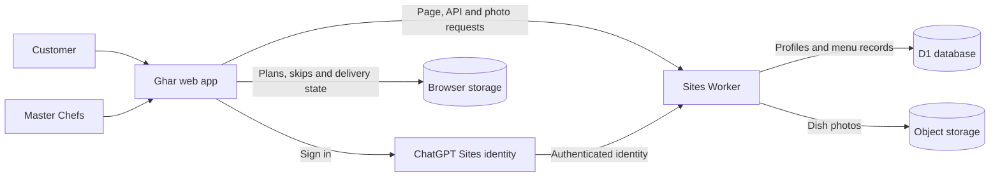

# Ghar Tiffin Platform — High-Level Design

The local HTTP server now applies a per-session rate-limit middleware before AI meal searches. It tracks a one-minute window and active request, returning Retry-After when the limit is reached. Limits use process memory. The selected three-viva demonstrations are mapped in [MARKING.md](MARKING.md).

**Implementation reviewed:** `main` at `f8f398f` · 15 November 2026

Ghar connects customers who want recurring tiffin meals with chefs who publish restaurant menus. Profiles, menus and dish photos persist on the hosted site. Subscriptions, meal skips and subscription delivery updates run as a browser-based demo. A customer on another device can see a chef’s published menu, but placing a demo subscription does not send an order to that chef or collect payment.

## 1. System architecture

The browser runs a Next.js and React interface with two workspaces. Customers browse kitchens, preview meals by date, and choose a plan. Master Chefs manage profiles, restaurant menus, pricing and the demo preparation queue. One signed-in account can use both workspaces. Switching views changes the interface. The server checks the signed-in account whenever a profile or menu is changed.

The build exports the frontend and packages its pages and assets with the API in one Worker. Pages, API requests and meal photos share an origin. The browser accesses hosted storage through the Worker.

## 2. Data ownership and storage

| Record | Where it lives | Ownership and lifetime |
| --- | --- | --- |
| Customer and chef profiles | D1, `ghar_profiles` | One record per account and role. Each profile has its own revision. |
| Published restaurant menus | D1, `ghar_kitchens` | One record per menu. Each has a stable ID, a chef owner, restaurant and menu names, dishes, schedule, prices, discounts and delivery areas. |
| Dish photos | Object storage, binding `BUCKET` | JPEGs are keyed by menu ID and image hash. Menu entries store photo references, so catalog reads do not transfer every image. |
| Demo subscriptions and activity | Account-scoped browser local storage | Stores plan snapshots, skips, pauses, favourites, ratings and delivery status. Clearing browser data can remove these records. |
| Role and theme | Browser session storage and local storage | The chosen role is scoped to the account and browser tab. The light or dark theme persists in the browser. |

**Restaurant grouping.** A chef can publish “Weekday lunch” and “Family dinner” under the same restaurant, each with different prices and supply days. The chef’s workspace groups menus by restaurant name, ignoring case and surrounding spaces. A restaurant has no separate database record. Renaming the restaurant on one menu moves that menu to a different group. Menus created before menu naming appear as **House menu**.

## 3. Main workflows

### Sign in and select a role

The visitor opens `/login/` and signs in with ChatGPT. After sign-in, `/choose-role/` asks whether to continue as a Customer or Master Chefs. The app opens `/customer/profile/` or `/master-chefs/profile/` and loads the account’s saved profile. The header switcher lets the same person move between the two views.

### Publish, edit or delete a menu

1. In **Master Chefs → Restaurant menus**, the chef selects **Create menu**, or **Add menu** under an existing restaurant. Each menu gets its own base price, weekly and monthly discounts, coverage and supply schedule.
2. The chef chooses a full seven-day rotation or selected supply days. Selected days can combine recurring weekdays with individual calendar dates. A date-specific entry overrides the recurring dish and photo for that date.
3. The browser resizes each uploaded meal photo and encodes it as JPEG. On publication, the Worker validates the menu, writes new photos to object storage and saves their references with the menu in D1. Signed-in customers then see the menu in the catalog.
4. Editing and deletion require the owner and the current revision. Deletion clears the stored menu settings, marks the row deleted and removes the listing from browsing. Existing local subscriptions retain their checkout snapshots. Deleting a menu does not erase its photo objects.

### Subscribe and fulfil a demo plan

The customer previews the dish, photo and supply dates, then selects a start date, delivery locality, meal slot and plan length. At checkout the app checks that a published menu still exists at the displayed revision. It captures the agreed price, menu and schedule in the browser so a later edit does not reprice an existing subscription.

Plans cover **1, 7 or 30 supply days**. Lunch and dinner count separately. The total is the base meal price multiplied by supply days and meals per day, with the selected discount applied and the result rounded to the nearest rupee. For example, seven lunch deliveries at ₹100 with a 10% weekly discount cost ₹630. A kitchen serving only Mondays supplies those seven lunches across seven Mondays.

The scheduler uses Bengaluru delivery dates and slots in **Asia/Kolkata**. A customer can skip a meal before the two-hour cutoff or pause a future date range for up to 90 days. The scheduler moves the affected meals to eligible supply dates and rejects a change if the published dates cannot cover the remaining meals. In the demo kitchen queue, a meal progresses from **Preparing** to **Out for delivery** to **Delivered**.

## 4. Service interfaces and consistency

| Interface | Responsibility |
| --- | --- |
| `GET /api/account` | Return the signed-in identity and that account’s role profiles. |
| `PUT /api/profile/{role}` | Validate and save the customer or cook profile against its revision. |
| `GET /api/kitchens` | Return active published menus and the menu IDs owned by the caller. |
| `PUT /api/kitchens` | Create a menu or update an owned menu at the expected revision. |
| `DELETE /api/kitchens` | Remove the specified owned menu at the expected revision. |
| `GET /api/menu-photos/{menuId}/{hash}` | Serve a stored JPEG to a signed-in visitor. |

The hosted Worker trusts identity supplied by Sites. Profile and menu writes require a same-origin request and server-side validation. Revision checks prevent an older tab from overwriting a newer edit. A stale write returns a conflict so the chef can reopen the current version. Reusing a menu creation key cannot create a duplicate row.

Menu metadata and photo bytes are stored separately. A failed or conflicting database save after a photo upload can leave an unreferenced image in the bucket. The current implementation has no automatic photo cleanup. The catalog also returns all active menus in one response and the browser filters them locally.

## 5. Deployment and verification

| | Hosted site | Local preview |
| --- | --- | --- |
| Frontend and API | A Sites Worker serves the exported frontend and authenticated API. | A Node.js server on loopback serves the built frontend and uses the same account and menu handlers. |
| Identity | ChatGPT sign-in via Sites | Local preview account with a session cookie |
| Data and photos | D1 through `DB`, object storage through `BUCKET` | SQLite and photo files under `.local/` |

With Node.js 22.18 or newer, run `npm install` and `npm run dev` to build and open the local preview at the URL printed in the terminal. Run `npm test` for profile ownership, menu lifecycle, pricing and scheduling checks. The build also verifies that all five application routes can load their JavaScript.

For implementation details, start with `components/Platform.jsx` for workspace navigation, `components/RestaurantMenus.jsx` for menu management, `lib/domain.mjs` for subscription rules, and `worker/account.mjs` and `worker/kitchens.mjs` for the hosted API. Database migrations live in `drizzle/`.

## Local viva edition

The Node server serves the existing static dashboard and forwards account operations to the existing worker handlers using SQLite and a local photo directory. It also serves a request-time HTML meal finder. The finder reads active restaurant menus from the same SQLite table and combines them with the verified sample kitchens.

Ollama generates a search query, embeds the query and menus, and selects a quote tool using the retrieved evidence. Redis can reuse menu embeddings across requests. Ghar's pricing function computes the quote. Authenticated WebSocket clients receive a catalog change event after a successful menu write and fetch the latest state. Stripe test Checkout is a separate, customer-initiated step with a session-bound return receipt.

The Compose configuration runs the app and Redis on a private network with optional Ollama. The existing hosted worker continues to provide its original account and menu experience. See [VIVA.md](VIVA.md) for the runtime requirements and demonstration.

## One-time delivery architecture

The customer and chef dashboards use the authenticated orders endpoint. The server reads the latest menu revision, validates the delivery date and slot, calculates the total and stores an order snapshot in SQLite locally or D1 when hosted. Each order records the buyer and the publishing chef. The chef's status update writes the transition and timestamp together. Both dashboards refresh every eight seconds and on focus. Order history is independent of subsequent menu changes.
