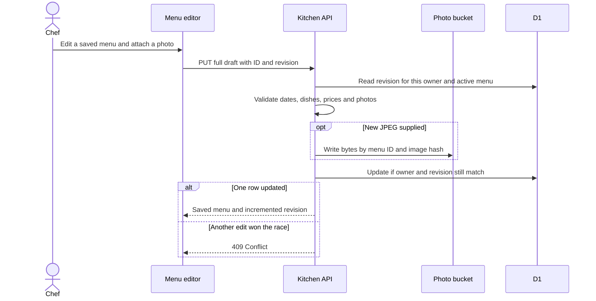

# Ghar Tiffin Platform — Low-Level Design

The local server calls `createMealSearchLimit` before route handling. POST requests to `/meal-finder/` with a valid session consume one of six requests per minute. A concurrent request from the same session receives HTTP 429. The accepted request returns a release callback, invoked by the server in finally. Expired idle counters are pruned on subsequent searches. Other paths proceed to their normal handlers.

**Source revision** `f8f398f` · [Companion high-level design](HLD.md)

Ghar persists account profiles, published restaurant menus and meal photos on the server. Checkout creates a demo subscription in the customer’s browser. This boundary determines which account owns a write, which data another device can see, and what happens to an existing plan when a chef edits or deletes a menu.

## 1. Entry points and component contracts

| Component or module | Inputs | Responsibility and output |
| --- | --- | --- |
| `components/AccountEntry.jsx` | Page route and account response | Presents sign-in at `/login/`, asks for a role at `/choose-role/`, and opens `/customer/profile/` or `/master-chefs/profile/`. The internal value for Master Chefs is `cook`. |
| `components/Platform.jsx` | Account, initial role and requested view | Combines the live catalog with sample kitchens, holds navigation state and passes account-owned menus to the chef workspace. |
| `components/RestaurantMenus.jsx` | Owned menus, publish and remove callbacks | Groups a chef’s menus by trimmed, lowercased restaurant name. Opening an editor passes the selected menu or an initial restaurant name. Delete confirmation captures the selected menu and its revision. |
| `components/MenuEditor.jsx` | Existing menu or new draft, chef profile and current date | Edits one draft at a time. A numeric selection addresses a weekday. A date string addresses a calendar override. Submission passes the entire menu to `publish(draft)`. |
| `lib/kitchens.js` | Catalog API responses | `useKitchens()` loads on mount and window focus. A request counter prevents an older fetch from replacing a newer result. `kitchenCard()` adapts each published menu to a customer listing. |
| `components/MenuPreview.jsx` and `components/Customer.jsx` | Provider, selected date, timing and plan duration | Resolve the dish and photo for a date, quote a plan and recheck the published menu revision before checkout. |
| `lib/domain.mjs` and `lib/store.jsx` | Provider, plan, dates and current delivery state | The domain module calculates prices and scheduled meals. The store persists accepted changes under the signed-in account’s browser key. |
| `worker/serve.mjs`, `worker/account.mjs`, `worker/kitchens.mjs` | HTTP request and storage bindings | The Worker dispatches API requests, resolves identity, validates writes and reads or updates D1 and the photo bucket. |

## 2. Persistent data and identifiers

| Store | Key and fields | Meaning |
| --- | --- | --- |
| D1 `ghar_profiles` | Primary key `(user_id, role)`. Other columns are `details TEXT` and `revision INTEGER`. | One JSON profile per account per role. The first save creates revision 1. |
| D1 `ghar_kitchens` | `owner_id TEXT PRIMARY KEY`, `kitchen_id TEXT UNIQUE`, `settings TEXT`, `revision INTEGER`, nullable `chef_id TEXT`, `deleted INTEGER DEFAULT 0`. | Each row represents one menu. New rows use `menu:<kitchen_id>` as the storage key in `owner_id`. Ownership checks use `COALESCE(chef_id, owner_id)` to support old rows. |
| Object storage `BUCKET` | `<kitchen_id>/<sha256-of-JPEG>` | Stores image bytes. The corresponding meal entry holds a relative photo URL. Reusing the same image within a menu produces the same key. |
| Browser `localStorage` | `ghar-demo-v1:<userId>` | A versioned JSON object holds providers, subscriptions, saved kitchen IDs, ratings and order statuses. The theme preference uses `ghar-theme`. |
| Browser `sessionStorage` | `ghar-view:<userId>` | Records the chosen workspace for that account in the current tab. |

**Identifier mapping.** The API calls the stable menu identifier `kitchen_id` in SQL and `id` in JSON. Checkout copies it into `subscription.providerId`. Two menus at the same restaurant therefore have independent prices, revisions and subscriptions. The restaurant name is a grouping field on each menu. Renaming it on one draft moves that menu to its new group.

The migrations in `drizzle/` introduce profiles, then menus, then multi-menu ownership and deletion. Legacy menu rows retain their original IDs and use **House menu** when a saved menu name is absent.

## 3. HTTP contracts

Hosted requests reach the API through Sites. `handleAccount(request, env)` requires the trusted account ID and email headers supplied by Sites. The selected UI role controls navigation. The server derives the acting user from the authenticated request and checks ownership on edits and deletions. Writes require a matching `Origin` and an `application/json` content type.

| Method and path | Input | Successful response |
| --- | --- | --- |
| `GET /api/account` | Signed-in session | `{user: {id, email, name}, profiles: {...}}`. The profile map contains the roles already saved. |
| `PUT /api/profile/{customer\|cook}` | Role fields and expected `revision` | `{profile: {..., revision}}` |
| `GET /api/kitchens` | Signed-in session | `{mine, ownedIds, kitchens}`. `mine` is the legacy account-derived ID. `kitchens` contains active menus. `ownedIds` can include the caller’s deleted menu IDs. |
| `PUT /api/kitchens` | Complete menu settings. A new editor sends `createKey` and revision 0. An edit sends the saved `id` and revision. | `{kitchen: {..., id, revision}}` with final photo URLs |
| `DELETE /api/kitchens` | JSON body containing `id` and `revision` | `{id}` |
| `GET /api/menu-photos/{menuId}/{hash}` | Two 64-character lowercase hex values | JPEG bytes with private caching for 86,400 seconds |

**Profile fields.** Both roles require a name of up to 70 characters. A customer supplies `locality`, `diet` and `timing` from the allowed choices. A chef supplies `kitchen` (up to 80 characters), `cuisine` (70), `bio` (300, may be empty) and one or more supported delivery `areas`. Profile writes have an 8 KiB request limit.

**Menu example.** This create request publishes a recurring Monday lunch and an additional Wednesday meal. Weekday arrays start with Monday at index 0. Empty entries retain the positions of unused weekdays.

```json
{
  "createKey": "d2c91970-684e-4d31-a44c-d4d192570afd",
  "revision": 0,
  "name": "Garden Cafe",
  "menuName": "Lunch",
  "mode": "dates",
  "week": [
    {"dish": "Dal and roti", "photo": ""},
    {"dish": "", "photo": ""},
    {"dish": "", "photo": ""},
    {"dish": "", "photo": ""},
    {"dish": "", "photo": ""},
    {"dish": "", "photo": ""},
    {"dish": "", "photo": ""}
  ],
  "recurring": [0],
  "dates": {"2026-11-18": {"dish": "Paneer thali", "photo": ""}},
  "price": 100,
  "weekly": 10,
  "monthly": 20,
  "areas": ["HSR Layout"]
}
```

The API requires seven weekday entries, dish descriptions of up to 220 characters, and at least one supported delivery area. Weekly mode requires a dish every day. Selected-day mode requires at least one recurring weekday or one calendar date, with a dish on each active entry. The API accepts up to 180 individual dates. Base price is an integer from ₹30 to ₹2,000. Each discount is an integer from 0 to 100.

## 4. Publishing, concurrent edits and deletion



For creation, the server derives the menu ID from the signed-in account’s legacy ID and the draft’s creation key. The insert uses a uniqueness constraint. Retrying the same create key yields a conflict and prevents a duplicate listing. For edits, the final SQL update checks ownership, current revision and active status in the same statement. If two editors open revision 3, the first successful write advances it to 4. The second must reload before saving.

The editor accepts JPEG, PNG and WebP files up to 15 MiB. It converts each to JPEG, limits the longest side to 960 pixels and reduces quality to fit the upload limit. The server checks the JPEG signature and limits the encoded photo to 340,000 base64 characters. Menu writes have an 8 MiB request limit. Uploaded objects can remain in the bucket if a later database write fails.

Deletion checks the owner and revision, writes `settings='{}'`, sets `deleted=1` and increments the revision. The catalog omits the deleted listing. A customer with an open checkout rechecks availability before creating the local plan. An existing subscription retains the checkout snapshot. The delete operation leaves stored photo objects in the bucket.

## 5. Checkout and meal scheduling

`createSubscription(provider, values, now)` validates plan duration, meal timing, delivery area, address, slot and start date. The date must be a supply day between tomorrow and 90 days ahead. For a menu with only individual dates, enough dates must remain to fulfil the plan. The saved plan includes a UUID, provider ID, price, start, delivery settings, empty skip and pause lists, and zero credits. Published menus also supply a provider snapshot. Selected-day plans copy the recurring weekdays, explicit dates and last listed date.

| Function | Rule |
| --- | --- |
| `menuFor(provider, date)` | In selected-day mode, use the dated dish and photo first, then the recurring weekday entry. Return `null` on an unserved date. |
| `quote(rate, days, timing, settings)` | Round `rate × days × mealTypes(timing).length × (100 − discount) / 100` to whole rupees. Daily plans use zero discount. Seven- and 30-day plans read `weekly` and `monthly`, with defaults of 5 and 10. |
| `scheduledMeals(plan)` | Walk forward from the start date, skipping unserved and paused dates. Keep a separate counter for lunch and dinner. Skip individual meal keys and continue until each requested type has its full count. Stop after the last date of a date-only schedule or at the 3,660-day loop bound. |
| `skipMeal(plan, date, meal, now, status)` | Require a scheduled meal in Preparing state and a time strictly before the two-hour cutoff. Append `date:meal`, increment credits once and verify that selected-day plans still have enough supply dates. |
| `pausePlan(plan, start, end, today)` | Require a future, inclusive interval of up to 90 days that contains a scheduled meal and avoids existing pauses. Verify that the remaining supply dates preserve the meal count. |
| `setOrderStatus(current, next)` | Accept one forward step along **Preparing → Out for delivery → Delivered**. Order status is keyed by `planId:date:meal`. |

**Worked example.** With the menu above, a seven-day lunch plan starting Monday 16 November 2026 costs ₹630. The first three lunches fall on 16, 18 and 23 November. The Wednesday uses its dated paneer dish. For a noon delivery, the skip window closes at 10:00 a.m. India time, including the exact cutoff instant. Skipping that Wednesday in time extends the schedule to another eligible Monday.

## 6. Error handling and verification

API errors use a JSON `error` message. Validation failures return 400, missing identity 401, cross-origin writes 403, oversized requests 413 and unsupported write content types 415. An unavailable menu or an attempt to mutate another chef’s menu returns 404. Stale versions and duplicate creates return 409. The hosted Worker catches unhandled API failures and returns 503. Account and catalog JSON responses use private, no-store caching.

The local preview exercises the same account and menu handlers with a loopback session, SQLite database and local photo directory. The browser retains demo subscriptions on each device. Switching from a customer account on one device to a chef account on another therefore shares published menu changes but does not transfer the customer’s browser-based subscriptions into the chef’s queue.

| Verification entry point | Behavior covered |
| --- | --- |
| `tests/account.test.mjs` | Authentication, account ownership, profile revisions, independent restaurant menus, legacy records, photo reads and menu deletion |
| `tests/domain.test.mjs` | Pricing, India-time boundaries, date overrides, skip cutoffs, pause validation, entitlement preservation and delivery transitions |
| `scripts/check-worker.mjs` | Built pages, sign-in markup and script resolution for the five application routes |

Run `npm test` from the project root for the account and domain suites. Run `npm run build` to export the frontend, package the Worker and check its routes.

## Local meal finder

| Entry point | Behavior |
| --- | --- |
| GET /meal-finder/ | Requires a local session. Combines active SQLite menus and sample kitchens into request-time HTML. |
| POST /meal-finder/ | Validates delivery area, plan length and query. Filters supply, searches embeddings, selects a menu and calculates the lunch total. |
| POST /meal-finder/checkout | Validates origin, session, area, availability and the current server-calculated quote, then creates a Stripe test session with an idempotency key. |
| GET /meal-finder/receipt | Retrieves the Stripe session and checks paid status, currency, test mode and the initiating session before displaying the receipt. |
| WebSocket /meal-events | Authenticates the upgrade and sends a catalog invalidation after an accepted publish or deletion. |

Embedding keys include a hash of model name and menu evidence. A menu edit produces a different key when its searchable text changes. Redis entries expire after one day. Provider failures surface as a retryable message and catalog browsing continues. The checkout test receipt and browser demo subscription remain separate records.

## One-time order API

| Method | Route | Result |
| --- | --- | --- |
| GET | /api/orders?view=customer | Returns the authenticated buyer's active and completed orders. |
| GET | /api/orders?view=chef | Returns orders from menus owned by the authenticated chef. |
| POST | /api/orders | Creates a server-priced order snapshot from an active menu revision. A repeated request with the same buyer and order ID returns the saved order. |
| PATCH | /api/orders | The assigned chef can advance one stage. A conditional update rejects stale concurrent changes. |

Migration 0003 creates the order table and indexes for buyer and kitchen queries. Each row stores menu, dish, portions, address, delivery window, amount, status and timestamp history. Availability uses the next fourteen Bengaluru calendar dates and excludes slots whose start has passed.
